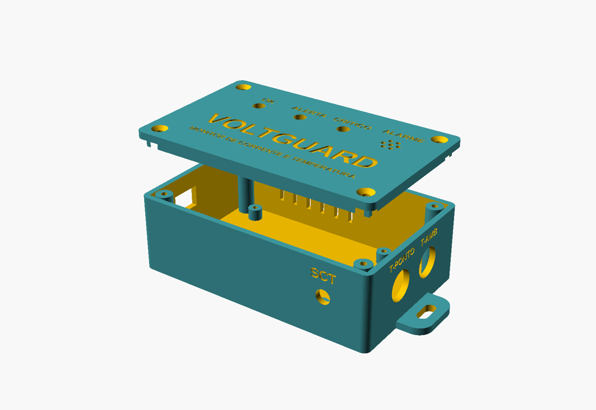
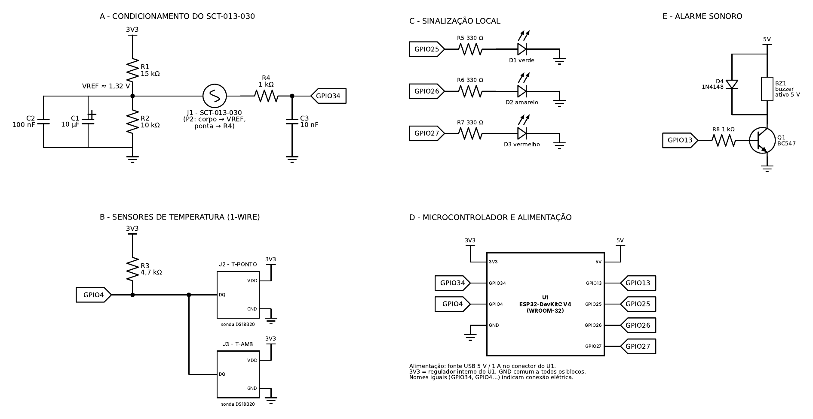
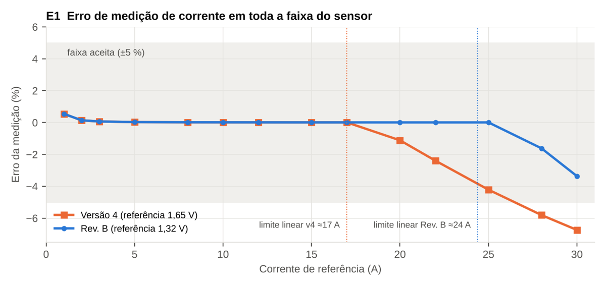
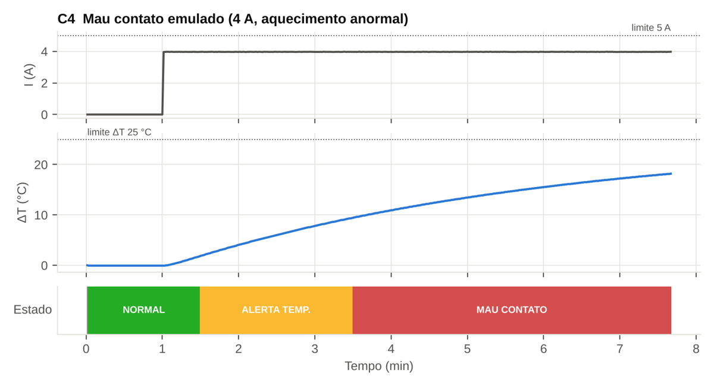
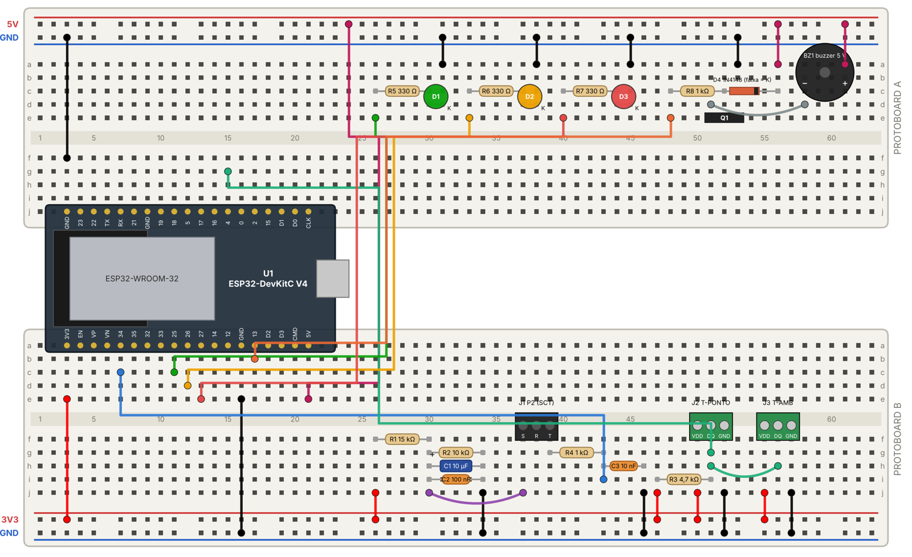

# VoltGuard

**Monitoramento de corrente e temperatura com ESP32 para detecção precoce de sobrecarga e mau contato em instalações elétricas.**

O VoltGuard mede, no mesmo ponto de um circuito, a corrente que passa pelo condutor e a elevação de temperatura do cabo em relação ao ambiente. Com essas duas grandezas, o firmware distingue sobrecarga, possível mau contato e aquecimento vindo de fora, e avisa por LEDs, buzzer e mensagem remota antes que o problema vire incêndio.

> **Situação do projeto:** protótipo acadêmico (Rev. B). Lógica de medição e diagnóstico validada em bancada virtual; ensaios físicos em andamento conforme o procedimento [VG-PE-05](ensaio/VoltGuard_Procedimento_de_Ensaio_RevB.pdf).



## Por que este projeto existe

Segundo o anuário da Abracopel (ano base 2025), os incêndios de origem elétrica no Brasil passaram de 606 para 1.304 ocorrências em cinco anos, e as instalações inadequadas foram a principal causa. Disjuntores protegem contra curto e sobrecorrente, mas não percebem um borne frouxo aquecendo com corrente normal. É essa lacuna que o VoltGuard procura cobrir.

## Como funciona

| Bloco | Componente | Função |
|---|---|---|
| Corrente | SCT-013-030 (30 A / 1 V), não invasivo | Mede a corrente eficaz no condutor |
| Temperatura | 2 sondas DS18B20 (ponto e ambiente) | Mede a elevação ΔT do cabo sobre o ambiente |
| Processamento | ESP32-DevKitC V4 | Cálculo RMS, tendência térmica e diagnóstico |
| Sinalização | LEDs, buzzer, MQTT por Wi-Fi | Alerta local e remoto |

O diagnóstico usa a física do problema: um mau contato só aquece quando há corrente passando por ele, e o aquecimento esperado de um cabo é proporcional ao quadrado da corrente (ΔT ≈ k·I²). O firmware compara o ΔT medido com o esperado e aplica histerese e tempos de confirmação para não gerar alarmes falsos.

| Estado | Condição |
|---|---|
| NORMAL | Corrente e temperatura dentro dos limites |
| ALERTA PREVENTIVO | Corrente acima do limite, ainda sem resposta térmica |
| SOBRECARGA | Corrente alta confirmada e cabo aquecendo |
| ALERTA DE TEMPERATURA | Elevação anormal ainda não confirmada |
| POSSÍVEL MAU CONTATO | ΔT muito acima do esperado para a corrente medida |
| AQUECIMENTO EXTERNO | Ponto quente sem corrente: o calor não vem do circuito |
| FALHA DE SENSOR | Sonda desconectada ou leitura inválida |

### Esquema elétrico



## Resultados da bancada virtual

O núcleo do firmware foi ensaiado sem alterações contra modelos físicos do sensor, do conversor do ESP32, do cabo e das sondas ([relatório VG-RE-06](ensaio/VoltGuard_Relatorio_Ensaio_Simulado_RevB.pdf)). Todos os critérios foram atendidos:

| Ensaio | Resultado |
|---|---|
| Exatidão de corrente entre 2 e 15 A | erro máximo de 0,14 % |
| Faixa linear do conversor | até cerca de 24 A (era 17 A na versão anterior) |
| Identificação da constante térmica do cabo | diferença inferior a 3 % |
| 7 cenários de diagnóstico, 3 repetições cada | 21 de 21 aprovados |
| Estabilidade com corrente oscilando no limite | 1 troca de estado, sem oscilação |




Esses resultados são simulados e servem de gabarito para os ensaios físicos; não substituem a bancada real.

## Estrutura do repositório

```
firmware/
  VoltGuard/            firmware do protótipo (Arduino IDE)
    voltguard_core.h      núcleo de medição e diagnóstico (C++ puro, testável no PC)
    voltguard_bancada.h   bancada virtual: modelos físicos para ensaio
  VoltGuard_Ensaio/     roteiro de ensaio automático que roda no ESP32
  test/                 testes unitários do núcleo e simuladores de hardware
wokwi/                  simulação interativa (potenciômetro como corrente)
wokwi_sct_chip/         simulação com chip personalizado que imita o SCT
wokwi_ensaio/           bancada virtual no Wokwi, com cenário para Wokwi CI
ensaio/                 procedimento de ensaio, relatório e bancada virtual no PC
cad/                    caixa para impressão 3D (OpenSCAD e STL)
desenho/                desenho técnico (esquema, base, tampa, montagem)
protoboard/             guia de montagem em protoboard e conferência automática
docs/img/               imagens usadas neste README
```

## Como começar

**1. Simular sem hardware.** Abra um projeto ESP32 em [wokwi.com](https://wokwi.com) e copie os arquivos da pasta `wokwi/`. O potenciômetro define a corrente e cada DS18B20 pode ter a temperatura ajustada com um clique.

**2. Rodar os testes no computador.**

```bash
cd firmware/test
g++ -std=c++17 -I../VoltGuard test_core.cpp -o test_core && ./test_core

cd ../../ensaio/sim
g++ -O2 -std=c++17 -I../../firmware/VoltGuard bancada_pc.cpp -o bancada && ./bancada
python3 graficos.py
```

**3. Gravar no ESP32.** Na Arduino IDE, instale o pacote *esp32 by Espressif Systems* e as bibliotecas OneWire, DallasTemperature e PubSubClient. Abra `firmware/VoltGuard/VoltGuard.ino`, selecione *ESP32 Dev Module* e grave. O monitor serial deve estar em 115200 baud.

**4. Montar em protoboard.** Siga o [guia VG-MP-07](protoboard/VoltGuard_Montagem_Protoboard_RevB.pdf), que traz o desenho furo a furo, a lista de fios e uma verificação ao fim de cada etapa.



**5. Imprimir a caixa.** Os arquivos `cad/voltguard_base.stl` e `cad/voltguard_tampa.stl` já estão orientados para impressão sem suporte. Recomenda-se PETG.

## Documentação

| Documento | Conteúdo |
|---|---|
| [VG-DE-01 a VG-MO-04](desenho/VoltGuard_Desenho_Tecnico_RevB.pdf) | Desenho técnico: esquema, lista de materiais, base, tampa e montagem |
| [VG-PE-05](ensaio/VoltGuard_Procedimento_de_Ensaio_RevB.pdf) | Procedimento de ensaio e demonstração |
| [VG-RE-06](ensaio/VoltGuard_Relatorio_Ensaio_Simulado_RevB.pdf) | Relatório da bancada virtual |
| [VG-MP-07](protoboard/VoltGuard_Montagem_Protoboard_RevB.pdf) | Guia de montagem em protoboard |
| [Guia detalhado](docs/guia-detalhado.md) | Simulação no Wokwi passo a passo, calibração, impressão 3D e Wokwi CI |
| [Falstad](wokwi/falstad_link.txt) | Circuito de condicionamento do sensor no simulador Falstad |

## Integração contínua

A cada envio de código, o GitHub Actions executa:
1. os testes unitários do núcleo;
2. a bancada virtual completa;
3. a conferência da montagem em protoboard contra o esquema;
4. a compilação do firmware para ESP32.

Se o segredo `WOKWI_CLI_TOKEN` estiver configurado no repositório, executa também o roteiro de ensaio dentro do simulador Wokwi.

## Segurança

O VoltGuard é um equipamento de **monitoramento e alerta**, não de proteção, e não substitui disjuntores, DR ou manutenção feita por profissional habilitado. O protótipo não tem ligação elétrica com a rede: o sensor apenas envolve o condutor isolado. Ensaios com cargas energizadas devem ser feitos com supervisão, em tomada protegida por DR, seguindo o procedimento VG-PE-05. Nunca provoque um mau contato real em borne energizado.

## Próximos passos

- [ ] Ensaios físicos completos do VG-PE-05 e comparação com a bancada virtual
- [ ] Ensaio térmico real para calibrar a constante k do cabo
- [ ] Registro de dados em CSV e painel web local no próprio ESP32
- [ ] Alertas pelo Telegram e configuração do Wi-Fi pelo celular
- [ ] Segundo canal de corrente e medição de tensão
- [ ] Placa de circuito impresso própria

## Equipe

Projeto desenvolvido no [Centro Universitário do Norte (UniNorte)](https://www.uninorte.com.br/), curso de *(Engenharia da Computação)*, sob orientação do Prof. Eng. Raul Batalha.

| Integrante |
|---|
| Samuel Filgueiras |
| Victor Uchoa |
| Bruno Falcão |
| Aline Pereira |
| Elionay Garcia |

**Orientador:** Prof. Eng. Raul Batalha

## Licença

Todos os direitos reservados. Consulte a equipe antes de reutilizar este material.
